<div align="center">

# Apurva Mukherjee — Portfolio

### `Namaste(); I'm`

A personal site built like a product: a live terminal in the hero, a bookshelf of
case studies, a music player in the MacBook notch, and a black-and-red interface that
reacts to every hover. No template, no UI kit, all custom.

[](https://react.dev)
[](https://vitejs.dev)
[](https://tailwindcss.com)
[](https://www.framer.com/motion/)
[](https://github.com/apurvamukherjee/Portfolio/actions/workflows/deploy.yml)

**[apurva.space →](https://apurva.space)**

</div>

---

## 🎬 The film

[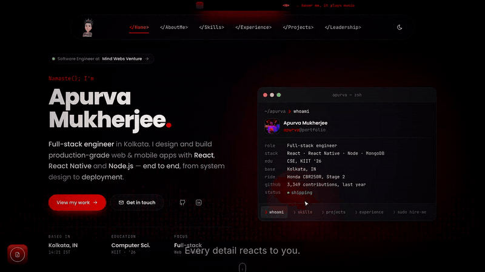](media/portfolio-film.mp4)

A 86-second tour of the site — subtitled, with an original score.
**[▶ Watch](media/portfolio-film.mp4)** · **[⬇ Download (MP4, 1080p)](https://github.com/apurvamukherjee/Portfolio/raw/main/media/portfolio-film.mp4)** · [Subtitles (.srt)](media/portfolio-film.srt)

---

## The hero

| Dark | Light |
|---|---|
| 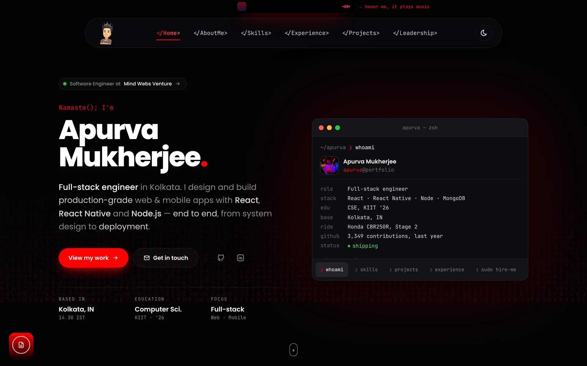 | 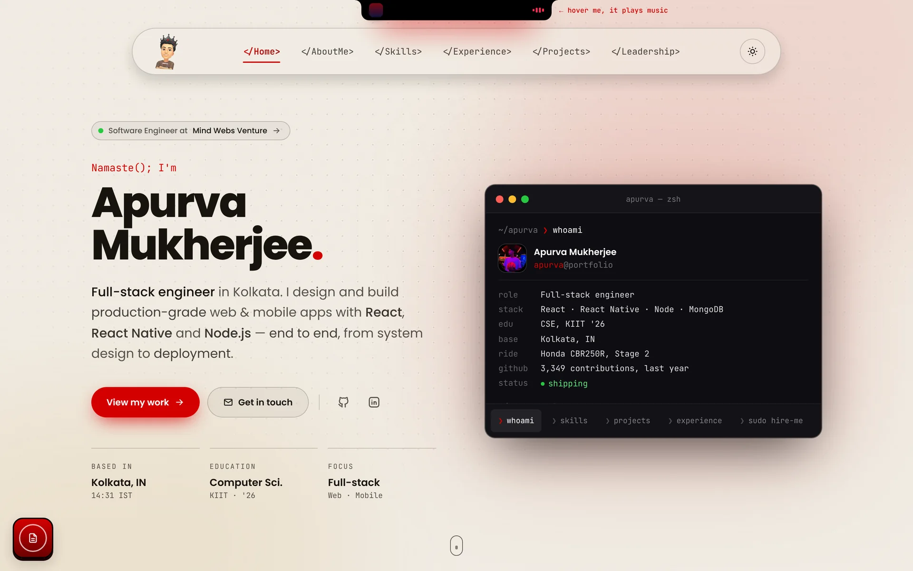 |

The first screen is meant to reward curiosity without getting in the way of reading:

- **A name you can light up.** A red spotlight follows the cursor across the letters,
  and the full stop hops when you hover it.
- **Words that decode.** The greeting and key phrases (*Full-stack engineer*,
  *production-grade*, *React*, *Node.js*…) resolve from random glyphs on load and
  scramble again on hover — laid over the real text, so nothing reflows and screen
  readers and copy/paste get the plain sentence.
- **Buttons with weight.** *View my work* drifts toward the cursor with a sweep of
  light; *Get in touch* carries a glow that follows the pointer.
- **A live terminal.** `whoami`, `skills`, `projects`, `experience` and
  `sudo hire-me` each type themselves out and render a small structured view.

<p align="center">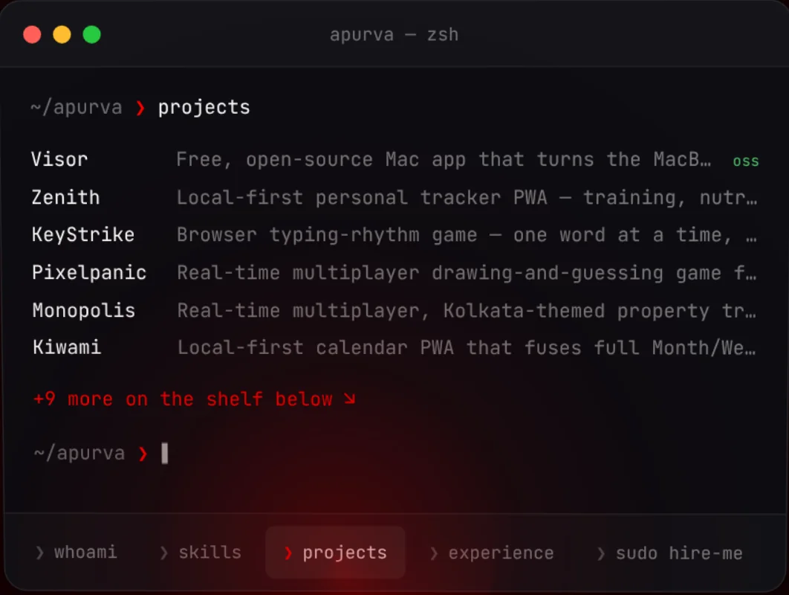</p>

## A look around

| | |
|---|---|
| 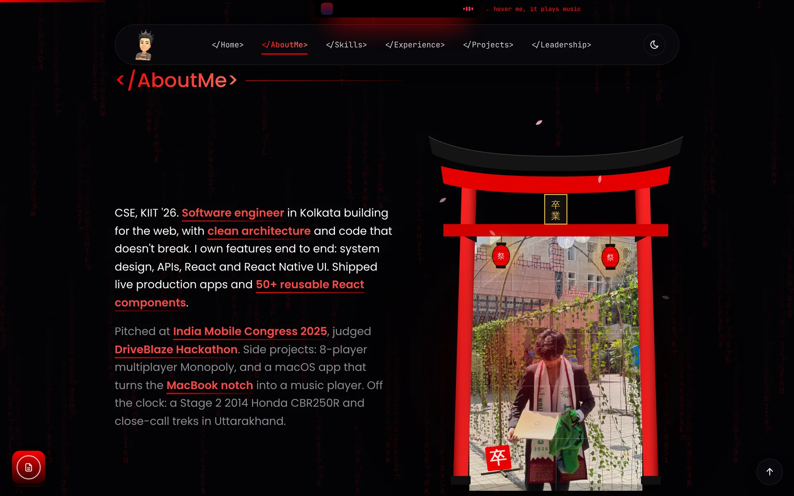 | 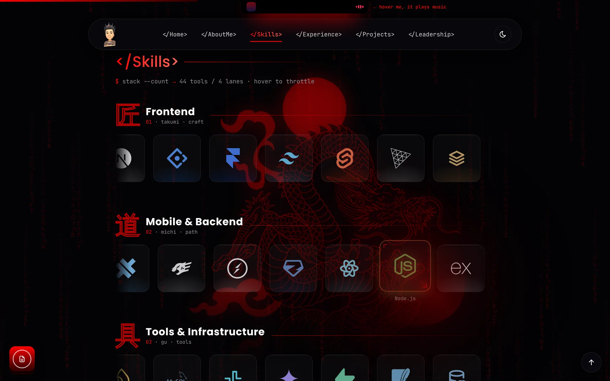 |
| 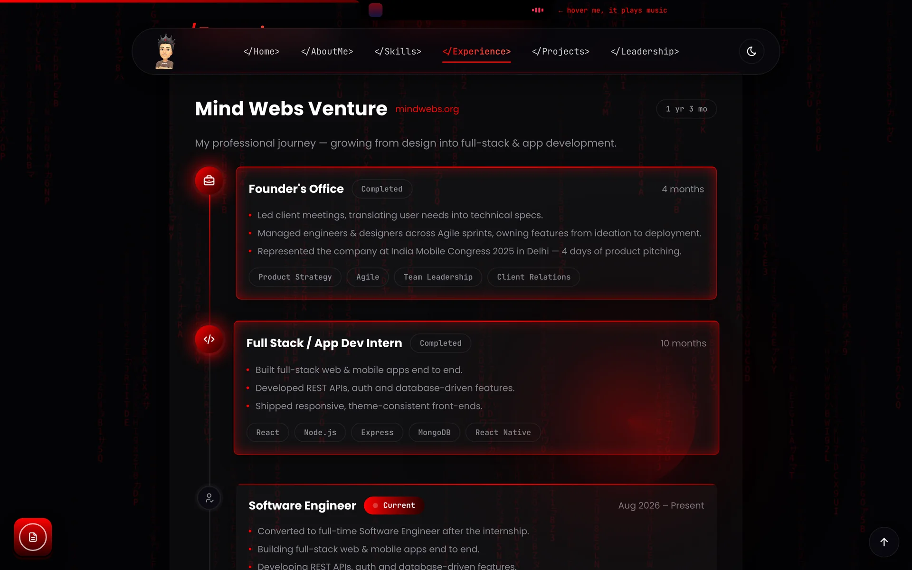 | 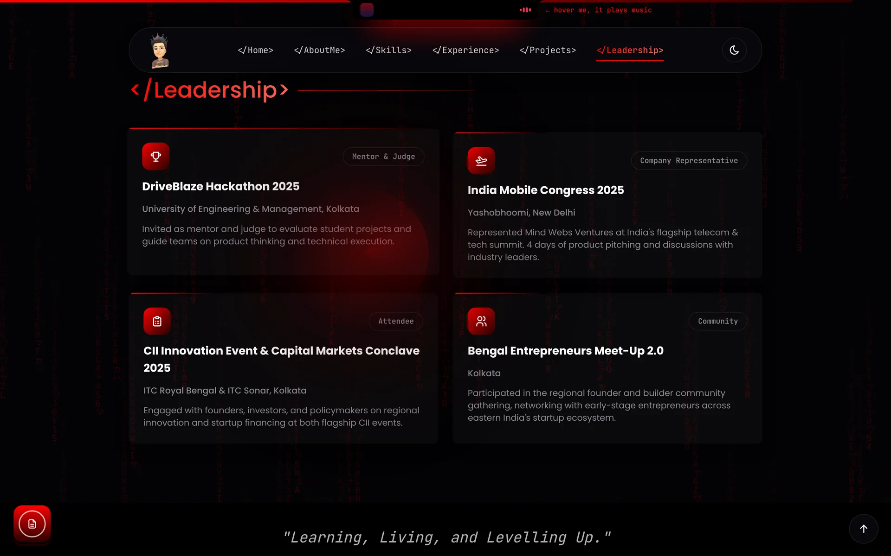 |
| 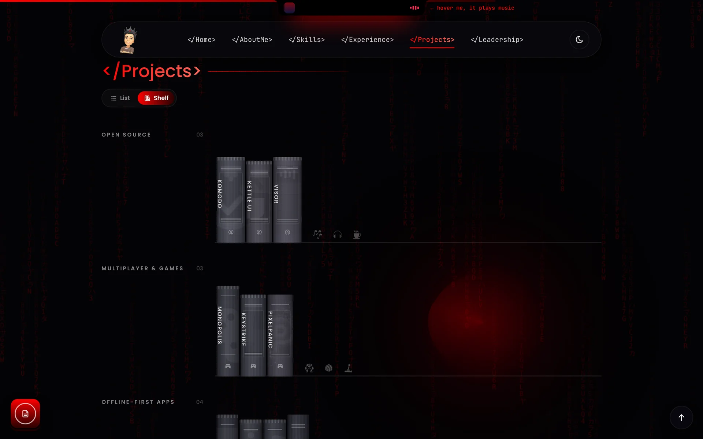 | 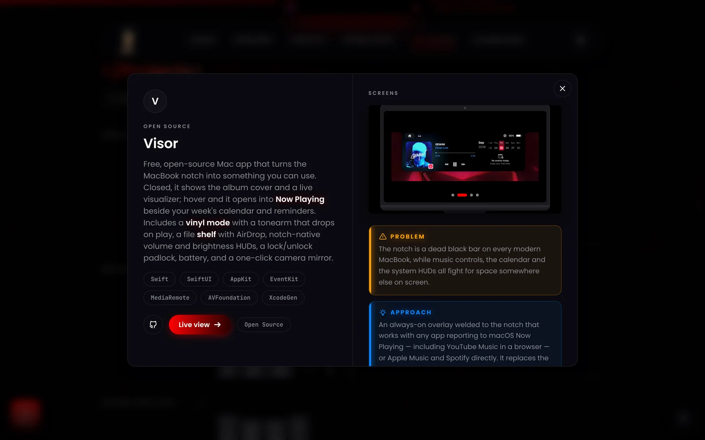 |

- **About** — highlighted phrases link to the section they talk about; live GitHub and
  LeetCode numbers sit underneath, cached for an hour and never invented when an API
  is down.
- **Skills** — 44 tools across four marquee lanes that slow down under the cursor,
  with a line-art dragon that reveals itself as you scroll.
- **Experience** — a timeline whose line fills, and whose checkpoints light up, as
  you scroll through it.
- **Projects** — 15 projects shelved like books by category. Pull one out for a
  **problem → approach → impact** case study, screenshots and links; or flip to a
  list view.
- **Leadership** — hackathons judged, stages pitched on, communities built.

## Keyboard-first

<p align="center">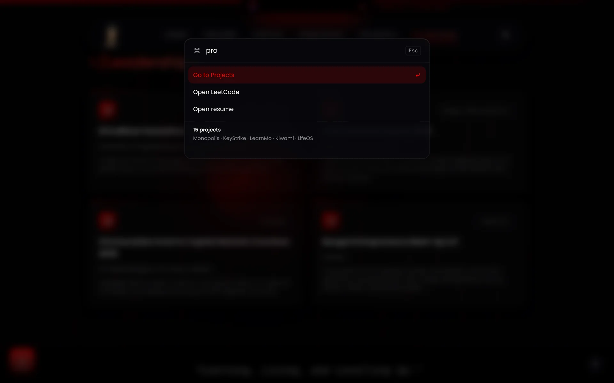</p>

- **`⌘K` / `Ctrl+K`** opens a fuzzy command palette: jump to any section, copy the
  email address, open the résumé or socials, switch theme.
- **Type `sudo`** anywhere for a full interactive terminal (`help` lists commands).
- **↑ ↑ ↓ ↓ ← → ← → B A** turns the rain green for ten seconds.
- Escape closes every overlay, focus is trapped and restored, and every effect
  respects `prefers-reduced-motion`.

## On your phone

<p align="center">
  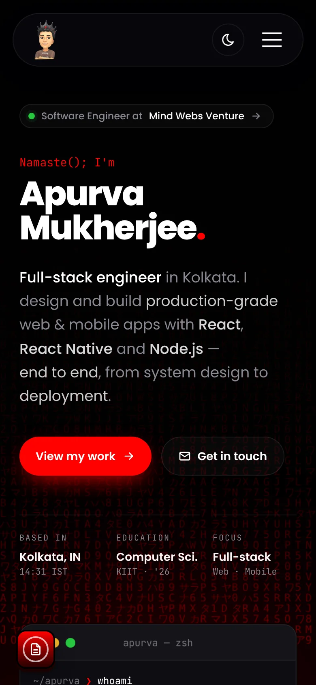
  &nbsp;&nbsp;
  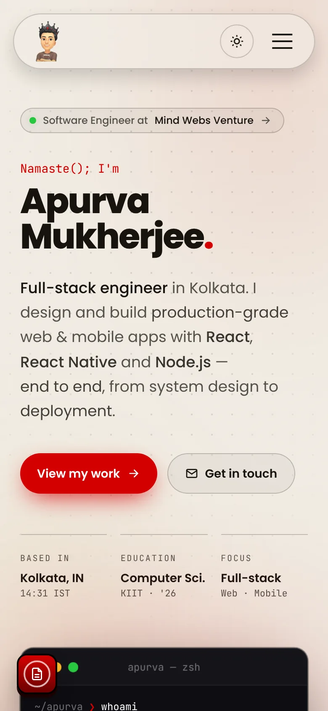
</p>

A real mobile layout rather than a squeezed desktop: a full-screen menu that
closes on Escape and lands each section clear of the navbar, touch-sized targets,
and hover effects that switch off on touch screens so nothing gets stuck.

## Details worth knowing

- **Two themes, both designed.** Dark mode runs a Matrix-style rain on a canvas
  behind everything; light mode sits on warm paper with a faint dot grid and soft
  washes. Switching themes plays a circular reveal from the toggle.
- **The notch is a music player.** Hover the island at the top on a laptop-sized
  screen for a calendar, a file shelf and 30-second Apple Music previews.
- **Section jumps wipe, not scroll** — powered by the View Transitions API, with a
  smooth-scroll fallback.
- **Fast on purpose.** The command palette, terminal and preloader are code-split;
  scroll effects are compositor-only; the light background is static.

## Stack

| Layer | Choice |
|---|---|
| UI | React 19 + TypeScript, Vite 8 |
| Styling | Tailwind CSS v4 (CSS-first config), JetBrains Mono + Poppins |
| Motion | Framer Motion, CSS scroll-driven animations, View Transitions |
| State | Zustand (notch player) |
| Icons | `react-icons` (Simple Icons + Tabler) |
| Tooling | oxlint, GitHub Actions → GitHub Pages |

## Structure

```
src/
  components/
    layout/      Navbar, mobile menu, footer, preloader, floating buttons
      visor-notch/   The notch music player, calendar and shelf
    sections/    One component per section — Hero, HeroShell (terminal),
                 HeroEffects, About, Skills, Experience, Projects, Leadership
      bookshelf/     Shelf, Book, OpenBook — the projects bookshelf
    shared/      Command palette, terminal, Matrix rain, cursor spotlight, ...
  data/          All content as typed data — projects, skills, experience, ...
  hooks/         useTheme, useScrollSpy, useMagnetic, useGithubStats, ...
  lib/           Motion presets, section transitions, fuzzy match, caching
media/           The portfolio film, its subtitles and the README teaser
screenshots/     README screenshots
```

Everything on the page — projects, skills, timeline, leadership, links — lives in
`src/data/*.ts` as plain typed objects. The components just render what's there.

## Run it locally

```bash
npm install
npm run dev      # http://localhost:5173
npm run build    # type-check + production build into dist/
npm run preview  # serve the production build
npm run lint     # oxlint
```

## Deployment

Every push to `main` builds the site and publishes `dist/` to GitHub Pages via
GitHub Actions, served on the custom domain [apurva.space](https://apurva.space).

## About the film

Recorded from the production build with Playwright (a real browser, scripted
hovers, clicks and scrolls), cut together with ffmpeg, and scored with an original
track synthesized for it — no stock footage, no licensed music.

---

<div align="center">Designed &amp; built by Apurva Mukherjee</div>
